# Spine Pain Guide · रीढ़ दर्द गाइड

**Live:** https://reedhguide.onrender.com (Render) · https://harshit7922.github.io/spine-pain-guide/ (GitHub Pages) — open it on a phone and tap **Install app** to add it to the home screen (works offline).

A self-assessment tool for spine and joint pain (now including the shoulder, knee, leg, ankle, foot, hip and groin) in English and Hindi. It asks where it hurts, how it started and how it behaves, runs a few safe bedside tests, checks warning signs, then shows the likely causes, how urgent it is, which specialist to see, realistic 3D pictures of the spine and nerves involved, and a PDF report for the doctor.

**It is decision support, not a diagnosis. Every result tells the person to see a doctor.**

### Made to be easy for everyone
- **Pick by picture:** the start page shows one card per body part, each with a 3D body and the area coloured.
- **Tap a word to understand it:** 47 medical words (disc, nerve root, sciatica, cauda equina, saddle area, facet joint, scapula, brachial plexus and more) have a dotted underline. Tapping one opens a realistic 3D picture and a plain meaning in English or Hindi, with its source. The words live in `data/glossary.js`.
- **Listen / सुनें:** reads the question, the answer choices or the result summary aloud using the phone's own voice (Hindi or English). Nothing is sent anywhere.
- **A+ (larger text)** in the top bar, remembered on the device.
- **"In short" box** at the top of every result: best match, how urgent, and which doctor to see first.
- **Continue where you left off:** answers are kept only in the browser on that device, so a person can close the app and carry on later or reopen the last result.
- **Share report:** on phones this opens the share sheet (WhatsApp, email) with the PDF attached; elsewhere it copies a short summary.

## Open it

Online: the link above. As an app: tap **Install app** (Android/Chrome installs directly; on iPhone use Safari → Share → Add to Home Screen). Offline on a computer:


Double-click `index.html`. Everything runs from this folder with no internet:
3D library (`lib/three.min.js`), PDF library (`lib/jspdf.umd.min.js`), research data (`data/`) and the app (`js/app.js`).
With internet the page uses IBM Plex / Source Serif fonts; offline it falls back to system fonts.

On first open it asks for the language (English / हिंदी). The choice is remembered and can be switched at any time from the top bar.

## Screenshots

| Start (desktop) | Result (phone) | Spine view, zoomed (phone) |
| --- | --- | --- |
| 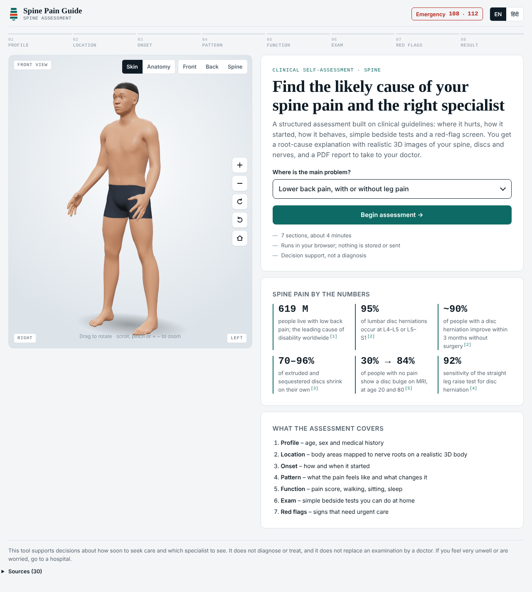 | 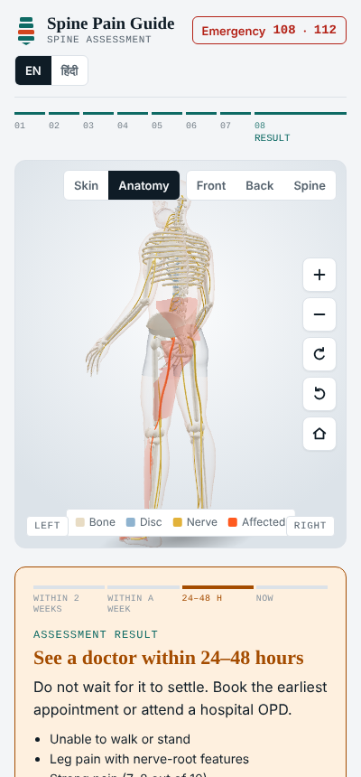 | 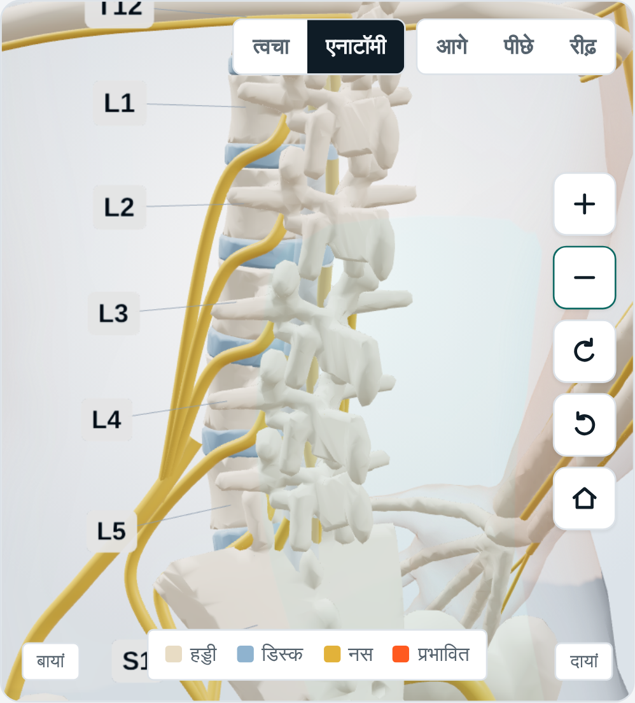 |

**Start page cards, the "In short" result box and a tapped word** (Hindi, phone):

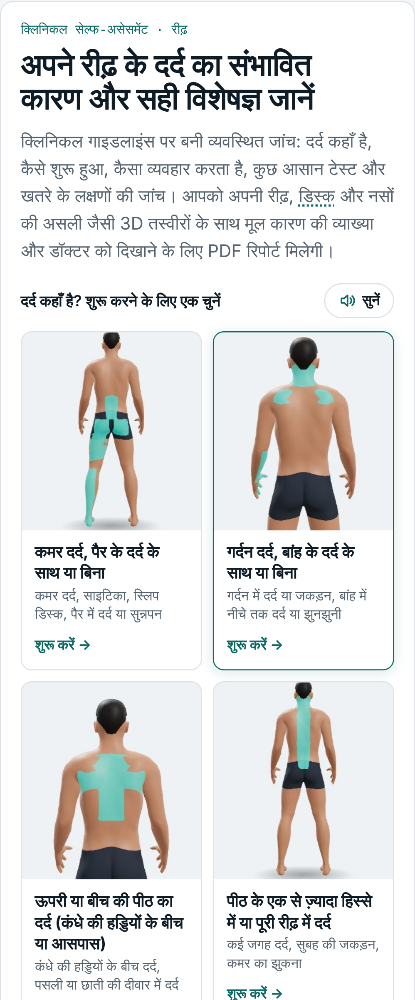 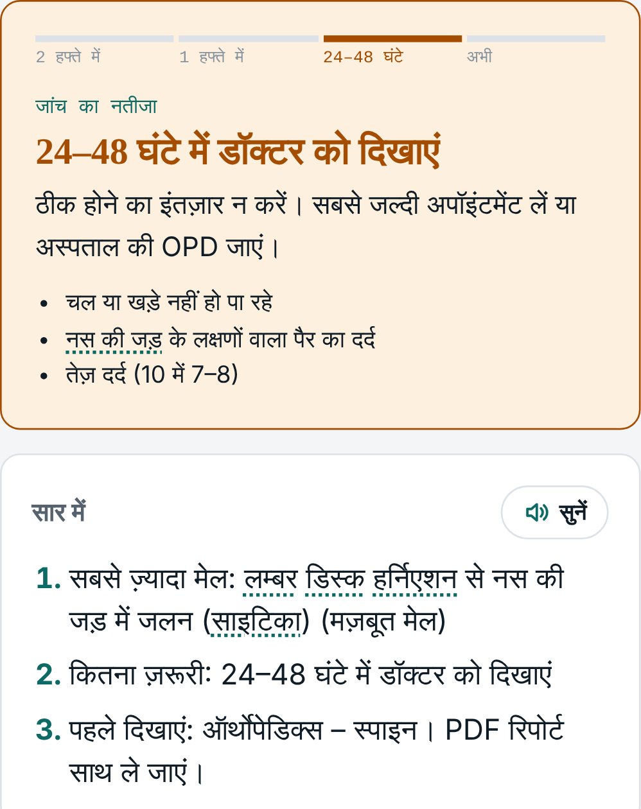 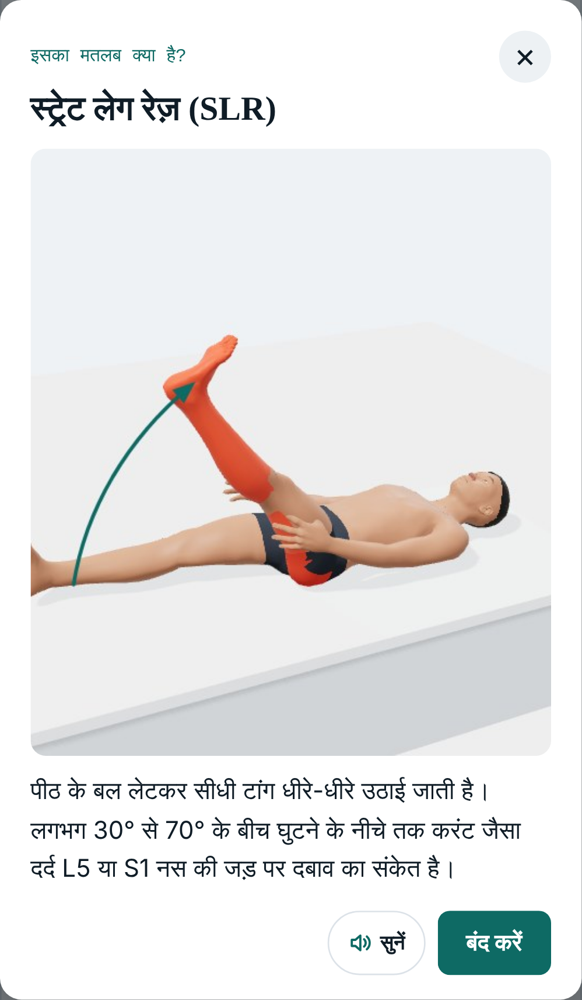

**Word pictures** (tap a dotted word anywhere in the questions or results):

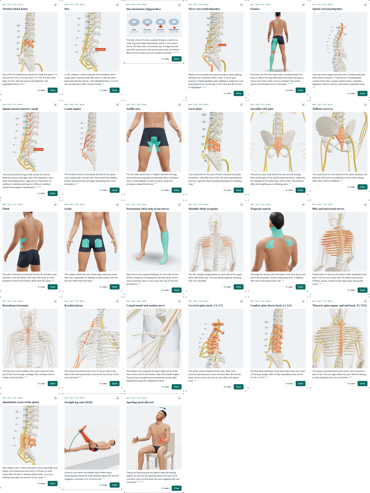

**Shoulder self-tests** (painful arc, slow lowering, turning out both forearms, reach across the chest):

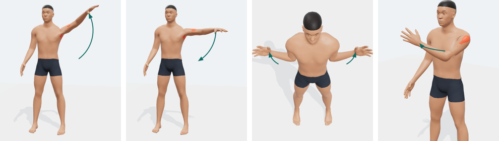

**Knee self-tests** (squat, joint-line press, straightening the knee):

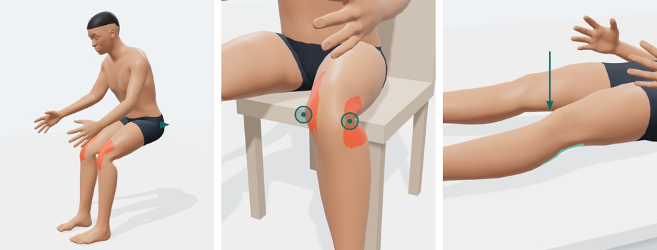

**Foot self-tests** (big toe lift, single-leg heel raise, squeeze between the toes):

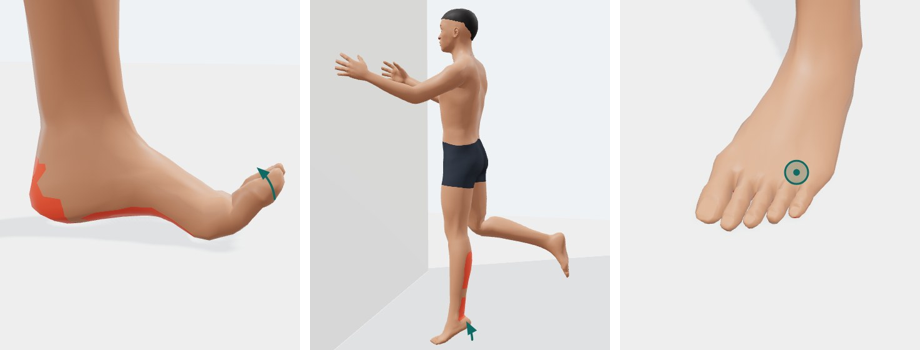

**Hip self-tests** (standing on one leg for 30 seconds, figure-4 position lying on a bed):

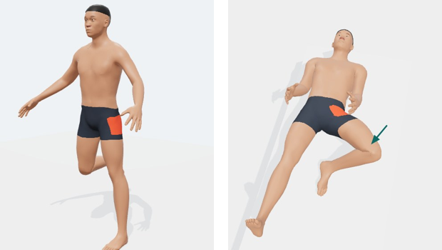

**Body-area questions with reference pictures** (Hindi, phone) and the **"when did it start" timeline**:

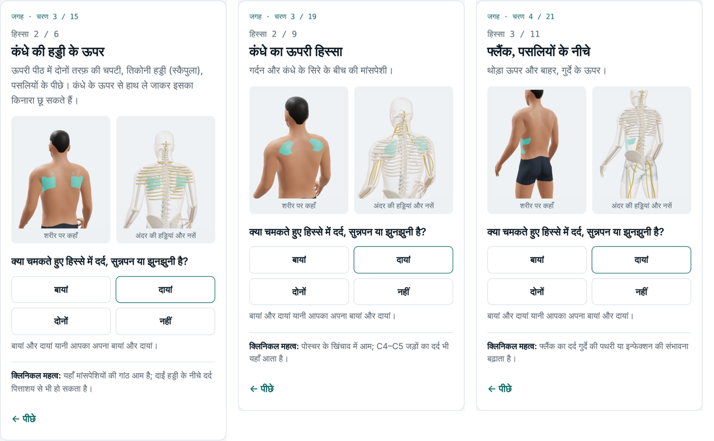

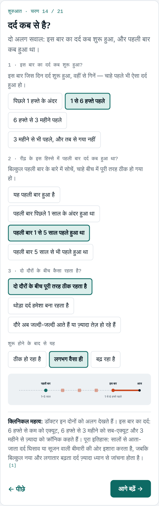

**Bedside self-tests**, each shown on a posed 3D body (red = where pain is felt if positive, green = muscles tested, arrows = movement). Women see a female body:

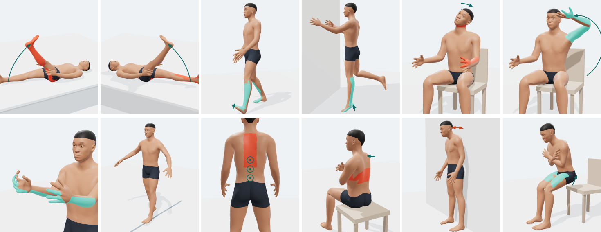

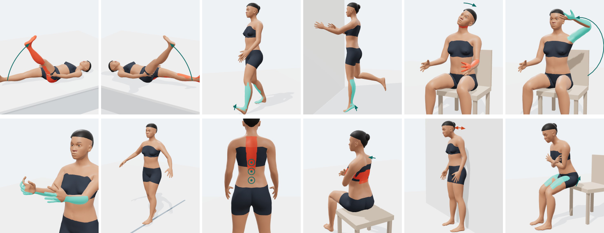

**Result pictures** for each spine region (numbered vertebrae, discs, nerves):

| Lower back | Neck and arm |
| --- | --- |
| 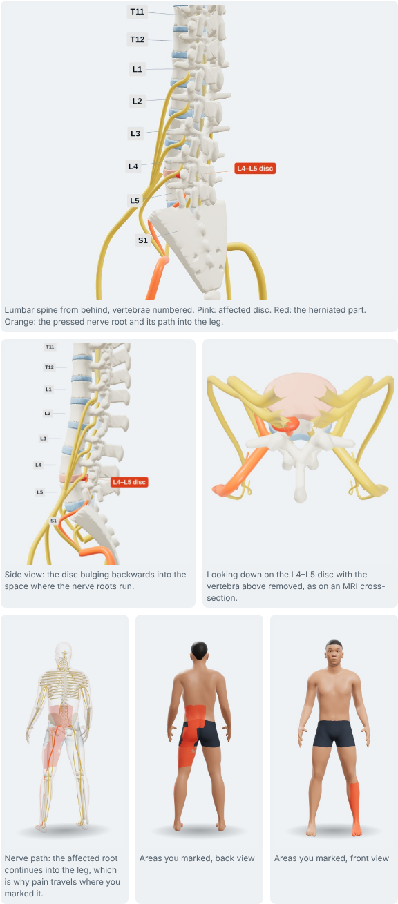 | 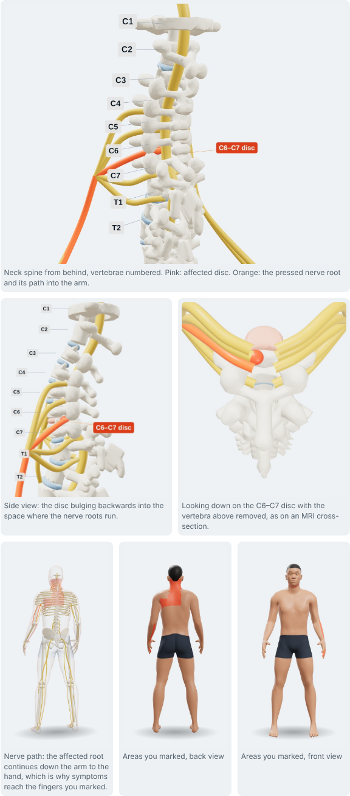 |
| **Upper and mid back** | **Whole spine** |
| 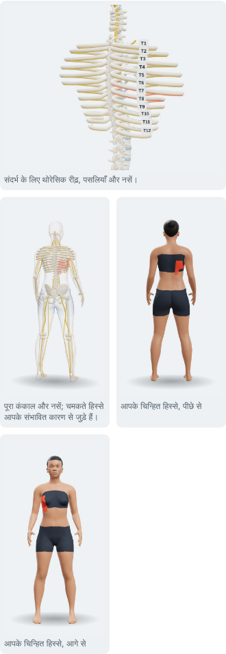 | 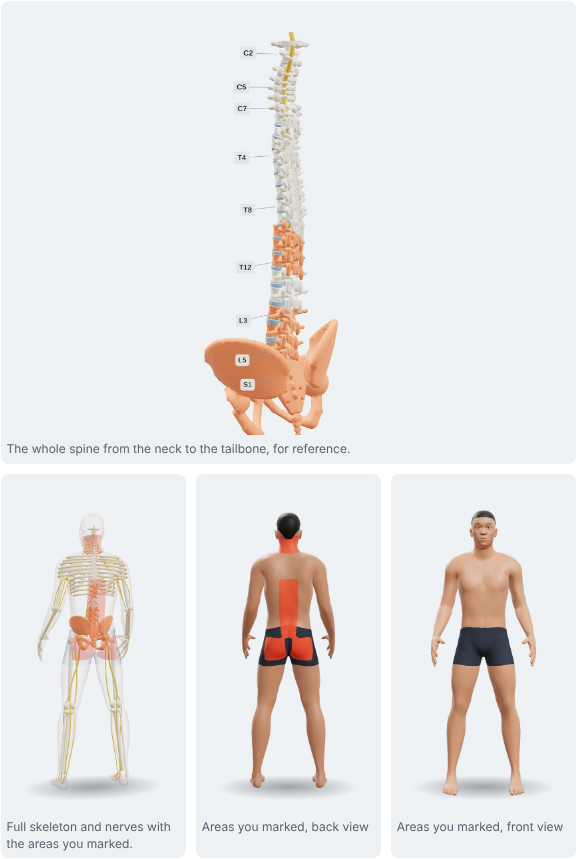 |

More: [language choice](docs/screenshots/desktop-language-choice.png), [desktop result](docs/screenshots/desktop-result.png), [SLR test in Hindi](docs/screenshots/phone-test-slr-hindi.png), [Spurling test in Hindi](docs/screenshots/phone-test-spurling-hindi.png), [neck lift test in Hindi](docs/screenshots/phone-test-neck-lift-hindi.png), [install on iPhone](docs/screenshots/phone-install-iphone.png).

Sample PDF reports (made from test answers, not real patients): [lower back](docs/sample-reports/report-lower-back.pdf) · [neck and arm](docs/sample-reports/report-neck-arm.pdf) · [upper back](docs/sample-reports/report-upper-back.pdf) · [whole spine](docs/sample-reports/report-whole-spine.pdf). Doctor review pack: [docs/clinical-review-pack.md](docs/clinical-review-pack.md).

## The parts of the body it covers

| Choice on the start page | Data file | Conditions | Emergencies checked |
|---|---|---|---|
| Lower back, buttock or leg | `data/lumbar.js` | 21 | cauda equina, cord, trauma, aortic aneurysm |
| Neck, shoulder blade or arm | `data/cervical.js` | 13 | cord compression, trauma, meningitis, stroke, heart attack |
| Upper or mid back, ribs or chest wall | `data/thoracic.js` | 13 | heart attack, aortic dissection, lung clot, trauma, cord |
| More than one part / whole spine | `data/whole.js` | 10 | cauda equina, cord, heart attack, trauma |
| Shoulder | `data/shoulder.js` | 10 | infected joint, dislocation or fracture, heart attack |
| Knee | `data/knee.js` | 12 | hot swollen joint, fracture (Ottawa rule), blood clot in the calf |
| Leg, ankle and foot | `data/foot.js` | 14 | fracture (Ottawa ankle rules), blocked artery, infected foot wound, blood clot, infected joint, Achilles rupture |
| Hip or groin | `data/hip.js` | 11 | broken hip after a fall, infected hip joint (including a limping child with fever), trapped hernia |

## Evidence tables

Each region has a plain-language evidence table listing every number the app shows, the likelihood ratios behind the scoring points and the sources: [lower back](research/lumbar-evidence.md) · [neck and arm](research/cervical-evidence.md) · [shoulder](research/shoulder-evidence.md) · [knee](research/knee-evidence.md) · [leg, ankle and foot](research/foot-evidence.md) · [hip and groin](research/hip-evidence.md). The order of work is in [research/ROADMAP.md](research/ROADMAP.md).

## Where the research lives (and how the calculation reads it)

The app has **no medical knowledge inside the code**. `js/app.js` is a generic engine; all research is in the data files, in both languages:

- `data/common.js` — sources list, all interface text, shared questions (age, sex, history, onset, duration), urgency levels, departments, statistics.
- `data/<module>.js` — for one spine region: body areas, symptom patterns, red-flag questions, bedside tests with accuracy figures, conditions with evidence weights, urgency rules, nerve-root rules, explanations (what it is, causes, how doctors confirm it, treatment, outlook).

How a result is calculated:
1. Every answer becomes a *feature* (e.g. `slr_pos`, `neck`, `ch_stiff_am`). Some features are derived (e.g. `radicular`).
2. Each condition adds up its weights for the features present → score.
3. Score ≥ thresholds `th:[strong, moderate, possible]` gives the strength. No anchor feature → capped at "possible". Rare serious conditions show as "rule out".
4. Urgency is separate: red (emergency now) → orange (24–48 h) → yellow (within a week) → green (doctor within 2 weeks).
5. Rules use a small language: `'feature'`, `{any:[…]}`, `{all:[…]}`, `{not:x}`, `{painGte:n}`, `{atLeast:[n,[…]]}`.

### To change or add research
1. Edit the data file (for example change a weight in `data/cervical.js`). Keep English and Hindi together: `L('English', 'हिंदी')`.
2. Reload `index.html` — the site uses the new numbers immediately.
3. Run the checks: `node tests/run_scenarios.js` (117 clinical scenarios must still pass).
4. Refresh the readable copies: `node tools/export_kb.js` then `python3 tools/build_xlsx.py`.
5. Rebuild the single-file version: `python3 tools/bundle.py` → `dist/spine-pain-guide.html`. This one file contains everything (use it for hosting or to send to someone); the hosted link is published from it.

### To add a new region (module)
Copy one module file, give it a new `id` and `order`, give it a `card` (body areas to colour, camera view and a one-line hint), add it to `index.html` after the other data files, and add test cases in `tests/cases/`. It then appears as a card on the start page automatically.

### To add a medical word
Add an entry to `data/glossary.js`: the words that should become tappable (English and Hindi), a title, a plain explanation, source keys and a picture spec (`skin` = body with an area coloured, `bone` = see-through body with bones or nerves highlighted, `svg` = a drawing, `pose` = a posed 3D body from a bedside test).

## Folder map

`docs/` holds the screenshots, 3D test pictures, sample PDF reports and the doctor review pack. `netlify.toml`, `vercel.json` and `_headers` let the same repository be hosted on Netlify, Vercel or Cloudflare Pages with no build step (see HOSTING.md).

```
index.html            open this
lib/                  three.js r128 (MIT), jsPDF 2.5.1 (MIT)
data/                 research data (edit these), glossary.js (tap-a-word pictures) + generated 3D data (body3d.js, spine3d.js, rig3d.js)
js/app.js             engine, screens, 3D viewer, PDF report
research/             spine-knowledge-base.json / .xlsx (all modules, EN + HI); personal case files stay out of git
dist/                 spine-pain-guide.html — the whole site in one file; web/index.html — same file, ready to host (see HOSTING.md)
tools/                export_kb.js, build_xlsx.py (rebuild the research copies), bundle.py (single-file version)
tests/                run_scenarios.js + cases/ (117 scenarios: hip, foot, knee, shoulder, lumbar, cervical, thoracic + whole, history, lumbar evidence)
3d-build/             Python scripts that generate the 3D bodies, bones and nerves (build.sh)
```

## 3D models

Male and female bodies come from the MakeHuman CC0 base mesh and targets. Vertebrae C1–coccyx, discs, ribs, pelvis, sternum, shoulder blades, arm and leg bones are modelled with signed-distance functions; the spinal cord, cauda equina, lumbar and cervical nerve roots, brachial plexus, arm nerves, sciatic/femoral nerves and intercostal nerves are tubes routed through the body. For the bedside-test pictures the same bodies are posed with a 52-bone skeleton (`data/rig3d.js`) — lying with a leg raised, seated with the head tilted, hand on head, walking on heels, rising on toes, against a wall, rising from a chair — with props, motion arrows and the area where symptoms appear coloured. `3d-build/build.sh` regenerates `data/body3d.js`, `data/spine3d.js` and `data/rig3d.js`; the poses themselves are listed in `TPOSE` in `js/app.js`.

---

## हिंदी में

यह रीढ़ के दर्द की खुद-जांच का टूल है (अंग्रेज़ी और हिंदी)। यह डायग्नोसिस नहीं है — हर नतीजे में डॉक्टर को दिखाने की सलाह दी जाती है।

- **खोलना:** `index.html` पर डबल-क्लिक करें। इंटरनेट की ज़रूरत नहीं। पूरी साइट एक ही फ़ाइल में चाहिए तो `dist/spine-pain-guide.html` खोलें।
- **चार हिस्से:** कमर/पैर, गर्दन/बांह, ऊपरी-बीच की पीठ/पसलियां, और पूरी पीठ — शुरू के पेज पर तस्वीर वाले कार्ड से चुनें।
- **आसान बनाने के लिए:** बिंदु वाली लाइन वाले मेडिकल शब्द पर टैप करें तो 3D तस्वीर के साथ आसान मतलब दिखता है; "सुनें" बटन सवाल और नतीजा पढ़कर सुनाता है; A+ से बड़े अक्षर; नतीजे के ऊपर "सार में" तीन लाइनें; अधूरी जांच बाद में वहीं से जारी; "रिपोर्ट भेजें" से PDF सीधे WhatsApp पर।
- **रिसर्च कहां है:** `data/` फ़ोल्डर की फ़ाइलों में — हर बीमारी, उसके लक्षणों के अंक (weights), खतरे के संकेत, टेस्ट और व्याख्या। ऐप इन्हीं फ़ाइलों से पढ़कर गणना करता है।
- **बदलाव करना:** डेटा फ़ाइल बदलें → `index.html` रीलोड करें → `node tests/run_scenarios.js` चलाएं → `node tools/export_kb.js` और `python3 tools/build_xlsx.py` से Excel/JSON कॉपी अपडेट करें।
- **पढ़ने लायक कॉपी:** `research/spine-knowledge-base.xlsx` में सभी बीमारियां, अंक, खतरे के नियम, नसें, टेस्ट और स्रोत हैं।
