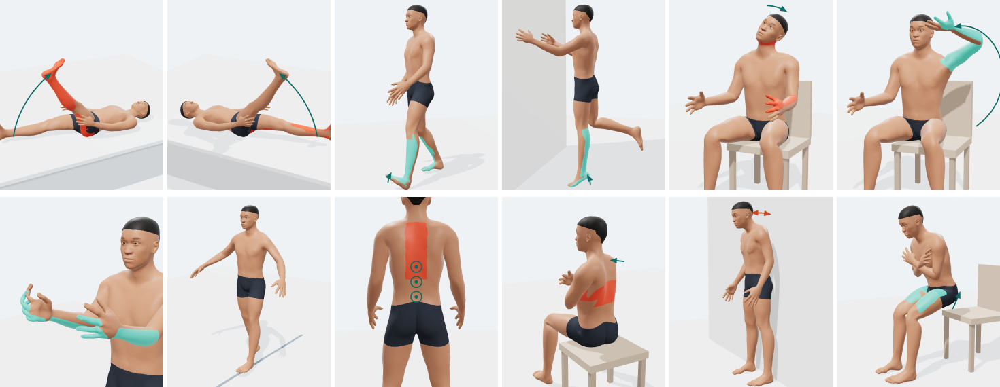

# Spine Pain Guide – Clinical Review Pack

Nov 4, 2026

## Purpose and what we ask you

Please check that the questions, scoring and urgency rules below are clinically safe before this self-assessment tool is shared with the public. It is decision support only: it never gives a diagnosis, and every result tells the person to see a doctor.

**What the tool is.** An offline web page in English and Hindi. A person picks the painful part of the spine, answers about 15–22 short questions (where it hurts on a 3D body, how and when it started, pattern, daily function, simple bedside tests, warning signs) and gets: an urgency level, the most likely causes, which specialist to see, 3D pictures of the spine and nerves involved, and a PDF to bring to the doctor.

| What it covers | Count |
| --- | --- |
| Spine regions (lower back, neck and arm, upper and mid back, whole spine) | 4 |
| Conditions scored | 54 |
| Emergencies checked (red level) | 18 |
| Urgency rules in total | 99 |
| Bedside self-tests | 12 |
| Test cases the scoring must pass | 48 |

**What we would like from you** (about 45 minutes):

1. **Safety first:** would any emergency or urgent case be missed or placed too low? (Urgency section)
2. **Likely causes:** are the strongest answers and thresholds for each condition reasonable? (Condition sections)
3. **Self-tests:** are the instructions safe for a person to do at home, and are the accuracy figures right? (Bedside tests)
4. **Wording:** anything a patient could misunderstand.

The full data (every weight, rule and question, in English and Hindi) is in the spreadsheet *spine-knowledge-base.xlsx*, in [`research/spine-knowledge-base.xlsx`](../research/spine-knowledge-base.xlsx).

## How the tool decides

The tool adds up evidence weights per condition and, separately, checks urgency rules; urgency never depends on which condition scores highest.

1. **Answers become features.** Each answer is a yes/no feature, e.g. "straight leg raise positive", "pain below the knee", "this bout started 1 to 6 weeks ago". A few features are derived, e.g. *radicular* = below-knee symptoms OR leg-dominant pain OR SLR positive OR crossed SLR positive OR shooting pain.
2. **Each condition scores its features.** Score = sum of the weights of the features present; negative weights count against (e.g. fever −3 for disc herniation).
3. **Strength.** Score ≥ threshold 1 → strong match; ≥ threshold 2 → moderate; ≥ threshold 3 → possible. If none of the condition's *anchor* features is present, it is capped at possible.
4. **Rare, serious conditions** (tumour, infection, cord compression causes) are shown as "rule out" for the doctor, never as the likely cause.
5. **Urgency** is decided by separate rules: red (go to emergency now) → orange (doctor within 24–48 hours) → yellow (specialist within a week) → green (doctor within 2 weeks). The highest rule met wins.
6. **Specialist.** Emergency department first if red; otherwise the departments of the top conditions, with physiotherapy last.

**Worked example.** Man, 30s, left buttock and back-of-thigh pain, leg worse than back, started on getting up, shooting pain, worse sitting and bending, SLR positive, cannot walk normally. Disc herniation with nerve-root irritation scores 23 against a strong threshold of 14; next best is piriformis syndrome at 4 (possible). Urgency is orange because walking is not possible.

## Urgency and emergency rules

Every result ends in one of four levels; red overrides everything, and each level still tells the person to see a doctor (green = within 2 weeks). Red and orange rules are listed in full; yellow reasons are summarised per region (all 50 are in the spreadsheet).

| Region | Level | Reason shown to the patient | Triggered by |
| --- | --- | --- | --- |
| Lower back | Red – emergency now | Cauda equina syndrome | New difficulty passing urine, leaking urine, or loss of bowel control OR numbness around the genitals, inner thighs or back passage (saddle area) |
| Lower back | Red – emergency now | Possible spinal injury | Started after a major injury: road accident or fall from a height |
| Lower back | Red – emergency now | Progressive nerve damage | Weakness in one or both legs that is getting worse |
| Lower back | Red – emergency now | Possible abdominal aortic aneurysm | Sudden severe pain in the belly and back, or a pulsing lump in the belly |
| Lower back | Orange – within 24–48 h | Weakness on the heel-walk or heel-raise test | Weak on heel walk OR weak on heel raise |
| Lower back | Orange – within 24–48 h | Fever, night sweats or weight loss with back pain | Fever, night sweats or weight loss without trying |
| Lower back | Orange – within 24–48 h | New back pain with a history of cancer | Cancer, now or in the past AND NOT (this bout has lasted more than 3 months) |
| Lower back | Orange – within 24–48 h | Constant night pain at age 50 or over | Constant night pain that no position eases AND (age 50+ OR cancer history) |
| Lower back | Orange – within 24–48 h | Fracture risk: weak bones or age 60+ with a sudden strain or fall | (Osteoporosis or 3+ months of steroid tablets OR age 60+) AND (fall OR heavy lift OR bending OR blow to the back OR strong cough or sneeze) |
| Lower back | Orange – within 24–48 h | Unable to walk or stand | Cannot walk or stand |
| Lower back | Orange – within 24–48 h | Very severe pain (9–10 out of 10) | Pain ≥ 9/10 |
| Lower back | Orange – within 24–48 h | Flank pain with fever or urine symptoms | Flank pain AND (fever, night sweats or weight loss OR burning urine or blood in urine) |
| Lower back | Orange – within 24–48 h | Nerve pain that is getting worse | Getting worse AND nerve-root features |
| Neck and arm | Red – emergency now | Rapidly worsening spinal cord compression | Clumsy hands, weak legs or unsteady walking getting worse quickly, or new bladder problems |
| Neck and arm | Red – emergency now | Possible neck injury | Neck pain after a fall, road accident, diving or a blow to the head |
| Neck and arm | Red – emergency now | Possible meningitis | Fever with stiff neck, severe headache or dislike of bright light |
| Neck and arm | Red – emergency now | Possible artery tear or stroke | Sudden severe neck pain or headache with double vision, slurred speech, face drooping or dizziness |
| Neck and arm | Red – emergency now | Possible heart attack | Neck, jaw or left arm pain with chest pressure, sweating or breathlessness |
| Neck and arm | Orange – within 24–48 h | Arm weakness or inability to grip | Cannot lift the arm or grip |
| Neck and arm | Orange – within 24–48 h | Signs of spinal cord pressure | Clumsy hands, unsteady walking or electric shocks (Lhermitte) |
| Neck and arm | Orange – within 24–48 h | Fever, night sweats or weight loss with neck pain | Fever, night sweats or weight loss without trying |
| Neck and arm | Orange – within 24–48 h | New neck pain with a history of cancer | Cancer history AND NOT (this bout has lasted more than 3 months) |
| Neck and arm | Orange – within 24–48 h | Constant night pain at age 50 or over | Constant night pain AND (age 50+ OR cancer history) |
| Neck and arm | Orange – within 24–48 h | Very severe pain (9–10 out of 10) | Pain ≥ 9/10 |
| Neck and arm | Orange – within 24–48 h | Arm nerve pain that is getting worse | Getting worse AND nerve-root features |
| Neck and arm | Orange – within 24–48 h | Neck injury at age 60 or over | Age 60+ AND (vehicle jerk OR fall OR road accident OR blow) |
| Upper and mid back | Red – emergency now | Possible heart attack | Chest pressure or pain spreading to arm, neck or jaw, with sweating, nausea or breathlessness |
| Upper and mid back | Red – emergency now | Possible aortic dissection | Sudden, severe tearing or ripping pain between the shoulder blades |
| Upper and mid back | Red – emergency now | Possible blood clot in the lung | Sudden breathlessness, or coughing up blood |
| Upper and mid back | Red – emergency now | Possible spinal injury | Started after a major injury: road accident or fall from a height |
| Upper and mid back | Red – emergency now | Spinal cord compression | Leg weakness, numbness below the chest, or bladder or bowel problems |
| Upper and mid back | Orange – within 24–48 h | Pain brought on by exertion: heart checked first | Exertion such as climbing stairs or walking fast |
| Upper and mid back | Orange – within 24–48 h | One-sided band of burning pain or rash (shingles, best treated within 72 h) | Rash or blisters in a strip on one side OR (band-like one-sided pain AND burning skin sore to touch) |
| Upper and mid back | Orange – within 24–48 h | Pain on breathing with cough, fever or breathlessness | Cough, fever or breathlessness AND (sharp pain on a deep breath OR worse with breathing or coughing OR fever or weight loss) |
| Upper and mid back | Orange – within 24–48 h | Leg weakness or numbness with back pain | Weak, numb or stiff legs or difficulty walking |
| Upper and mid back | Orange – within 24–48 h | Fever, night sweats or weight loss with back pain | Fever, night sweats or weight loss without trying |
| Upper and mid back | Orange – within 24–48 h | New back pain with a history of cancer | Cancer history AND NOT (this bout has lasted more than 3 months) |
| Upper and mid back | Orange – within 24–48 h | Constant night pain at age 50 or over | Constant night pain AND (age 50+ OR cancer history) |
| Upper and mid back | Orange – within 24–48 h | Fracture risk: weak bones or age 60+ with a fall, lift or bad cough | (Osteoporosis or steroids OR age 60+) AND (fall OR lift OR bending OR blow OR strong cough OR after a chest infection) |
| Upper and mid back | Orange – within 24–48 h | Very severe pain (9–10 out of 10) | Pain ≥ 9/10 |
| Whole spine | Red – emergency now | Nerve compression affecting bladder or bowel | New difficulty passing urine, leaking, or loss of bowel control |
| Whole spine | Red – emergency now | Progressive nerve or cord damage | Weakness or numbness in arms or legs that is getting worse |
| Whole spine | Red – emergency now | Possible heart attack | Chest pressure with sweating or breathlessness |
| Whole spine | Red – emergency now | Possible spinal injury | Started after a major injury |
| Whole spine | Orange – within 24–48 h | Fever, night sweats or weight loss with pain | Fever, night sweats or weight loss without trying |
| Whole spine | Orange – within 24–48 h | New pain with a history of cancer | Cancer history AND NOT (this bout has lasted more than 3 months) |
| Whole spine | Orange – within 24–48 h | Constant night pain at age 50 or over | Constant night pain AND (age 50+ OR cancer history) |
| Whole spine | Orange – within 24–48 h | Very severe pain (9–10 out of 10) | Pain ≥ 9/10 |
| Whole spine | Orange – within 24–48 h | Shoulder and hip girdle stiffness after 50 (needs blood tests soon) | Morning stiffness and pain in both shoulders and hips AND age 50+ |

**Yellow – specialist within a week:**

- **Lower back:** leg pain with nerve-root features; bouts more often or worse; this bout over 6 weeks; inflammatory pattern; leg symptoms on walking that ease on sitting; groin pain; flank pain; tailbone pain over a week; age under 18 or over 60; pain 7–8/10; after a fall, blow or accident; urine symptoms; night pain at rest; pregnancy or recent delivery; pain disturbing sleep
- **Neck and arm:** arm pain with nerve-root features; bouts more often or worse; this bout over 6 weeks; inflammatory pattern; age under 18 or over 60; pain 7–8/10; after a jerk, fall or accident; night pain at rest; pain disturbing sleep; headaches with the neck pain; hand tingling at night
- **Upper and mid back:** chest pain with back pain; bouts more often or worse; this bout over 6 weeks; inflammatory pattern; age under 18 or over 60; pain 7–8/10; after a fall, blow or accident; pain after meals; rounded back or height loss; night pain at rest; pain disturbing sleep; urine symptoms
- **Whole spine:** pain in many body regions; pain in more than one part of the spine; bouts more often or worse; this bout over 6 weeks; inflammatory pattern; bone tenderness or weak thigh muscles; recent fever with body ache; rounded back, curve or height loss; numbness or tingling in the limbs; age under 18 or over 60; pain 7–8/10; pain disturbing sleep

## Lower back conditions

19 conditions. Thresholds are the score needed for strong / moderate / possible; rare serious conditions show only as "rule out" for the doctor.

| Condition | Thresholds | Strongest supporting answers (weight) | Main evidence against | First specialist |
| --- | --- | --- | --- | --- |
| Lumbar disc herniation with nerve root irritation (sciatica) | 14/8/4 | Symptoms below the knee (+4); Straight leg raise positive (+4); Crossed SLR positive (+4); Leg pain is worse (+3); Sharp, electric or shooting pain down the leg (+3) | Fever, night sweats or weight loss (-3); Leg symptoms on walking that ease on sitting (-2) | Orthopaedics – Spine |
| Muscle strain or ligament sprain | 9/6/3 | Muscle spasm; back feels locked or tilted (+3); First time ever with this pain (+2); Lower back, beside the spine (+2); Dull, deep ache (+2); Started: lifting something heavy (+2) | Symptoms below the knee (-4); Straight leg raise positive (-3) | Physiotherapy / PM&R |
| Facet joint pain / lumbar spondylosis | 10/6/3 | Worse: bending backwards (+3); Lower back, beside the spine (+2); Dull, deep ache (+2); Age 50–59 (+2); Age 60 or over (+2) | Symptoms below the knee (-3); Straight leg raise positive (-2) | Orthopaedics – Spine |
| Sacroiliac (SI) joint dysfunction | 9/6/3 | Buttock (+3); Started: pregnancy or after delivery (+3); Worse: getting up from sitting (+2); Completely fine between bouts (+1); Started: slip or fall (+1) | Symptoms below the knee (-2); Straight leg raise positive (-2) | Orthopaedics |
| Piriformis syndrome | 9/6/4 | Buttock (+2); Back of the thigh (+2); Worse: sitting (+2); Started: after long sitting, driving or travel (+2); Shooting pain down the leg (+1) | Lower back, centre (-2); Worse: coughing, sneezing or straining (-2) | Physiotherapy / PM&R |
| Lumbar spinal stenosis | 12/7/4 | Leg symptoms on walking that ease on sitting or bending forward (+4); Better: sitting or leaning forward (+3); Age 60 or over (+3); First had this pain more than 5 years ago (+2); Both legs (+2) | Age under 18 (-3); Age 18–29 (-3) | Orthopaedics – Spine |
| Spondylolysis / spondylolisthesis | 8/5/3 | Worse: bending backwards (+3); Age under 18 (+3); Started: twisting, sport or gym (+2); First had this pain within the last year (+1); Age 18–29 (+1) | — | Orthopaedics – Spine |
| Inflammatory back pain (axial spondyloarthritis) | 13/8/5 | Better: exercise (+3); Stiff for more than 30 minutes after waking (+3); This bout over 3 months (+3); Psoriasis, inflammatory bowel disease or recurring red eye (+3); First had this pain 1 to 5 years ago (+2) | This bout started within the last week (-2); First time ever with this pain (-1) | Rheumatology |
| Coccydynia (tailbone pain) | 8/6/4 | Tailbone (coccyx) (+6); Worse: sitting (+2); Started: slip or fall (+2); Started: pregnancy or after delivery (+2); Female (+1) | — | Orthopaedics |
| Hip joint disorder | 8/5/3 | Groin, front of the hip (+5); Age 60 or over (+2); First had this pain 1 to 5 years ago (+1); Some pain always stays between bouts (+1); Front of the thigh (+1) | Symptoms below the knee (-1); Straight leg raise positive (-1) | Orthopaedics |
| Upper lumbar nerve root irritation (L2–L4) | 10/6/4 | Front of the thigh (+4); Knee and inner shin (+3); Shooting pain down the leg (+2); First had this pain within the last year (+1); Numb patch on the leg or foot (+1) | Back of the calf, heel, sole (-1); Outer shin, top of foot, big toe (-1) | Orthopaedics – Spine |
| Kidney stone or kidney infection | 10/6/4 | Flank, below the ribs (+5); Burning urine or blood in urine (+4); Side pain that comes in waves (+3); Fever, night sweats or weight loss (+2); Completely fine between bouts (+1) | Muscle spasm (-1); Worse: bending forward (-1) | Urology |
| Spinal infection, including spinal TB | 9/6/4 | Fever, night sweats or weight loss (+5); TB now or before, or a TB patient at home (+3); First time ever with this pain (+2); Diabetes, HIV or low immunity (+2); Constant night pain (+2) | First had this pain more than 5 years ago (-2) | Orthopaedics – Spine |
| Vertebral fracture | 9/6/4 | Major injury: road accident or fall from a height (+4); Started: slip or fall (+3); Started: road accident (+3); Osteoporosis, or steroid tablets 3+ months (+3); Started: blow to the back (+2) | — | Orthopaedics – Spine |
| Tumour involving the spine (rare) | rule out (10/8/7) | Cancer, now or in the past (+5); Constant night pain (+3); First time ever with this pain (+2); Age 60 or over (+2); Bouts more often or worse (+1) | First had this pain more than 5 years ago (-2) | Orthopaedics – Spine |
| Pregnancy-related pelvic girdle pain | 8/6/4 | Started: pregnancy or after delivery (+5); Buttock (+2); Female (+1); Worse: getting up from sitting (+1); Tailbone (+1) | — | Obstetrics and gynaecology |
| Degenerative disc disease (discogenic pain) | 10/6/4 | First had this pain more than 5 years ago (+3); First had this pain 1 to 5 years ago (+2); Some pain always stays between bouts (+2); Lower back, centre (+2); Worse: sitting (+2) | Fever, night sweats or weight loss (-3); First time ever with this pain (-2) | Orthopaedics – Spine |
| Postural and myofascial back pain | 9/6/4 | Lower back, beside the spine (+2); Dull, deep ache (+2); Desk job or long sitting (+2); Started: after long sitting, driving or travel (+2); Some pain always stays between bouts (+1) | Symptoms below the knee (-3); Fever, night sweats or weight loss (-3) | Physiotherapy / PM&R |
| Gynaecological cause (endometriosis, fibroids, pelvic infection) | 8/6/4 | Pain that comes with periods (+6); Female (+1); Groin, front of the hip (+1); Lower back, centre (+1); Started slowly, no clear reason (+1) | — | Obstetrics and gynaecology |

## Neck and arm conditions

12 conditions; the arm strips asked are the C5, C6, C7, C8 and T1 skin areas, shown on the 3D body.

| Condition | Thresholds | Strongest supporting answers (weight) | Main evidence against | First specialist |
| --- | --- | --- | --- | --- |
| Cervical radiculopathy (disc or bone spur pinching a nerve root) | 14/8/4 | Spurling (gentle neck tilt) positive (+4); Thumb side of forearm, thumb and index finger (+3); Middle finger and middle of forearm (+3); Symptoms below the elbow (+3); Arm or hand pain is worse (+3) | Fever, night sweats or weight loss (-3); Spurling negative (-2) | Orthopaedics – Spine |
| Cervical myelopathy (cord compression) | 10/7/4 | Clumsy hands (+4); Unsteady walking or poor balance (+4); Grip-and-release slow (+4); Heel-to-toe walk failed (+4); Lhermitte (electric shock on bending the head) (+3) | Age under 18 (-3); Age 18–29 (-2) | Neurosurgery / Spine surgery |
| Neck muscle strain and postural neck pain | 9/6/3 | Worse: long screen or phone use (+3); First time ever with this pain (+2); Back and sides of the neck (+2); Top of the shoulder (+2); Dull, deep ache (+2) | Symptoms below the elbow (-3); Spurling positive (-3) | Physiotherapy / PM&R |
| Cervical spondylosis (neck arthritis) | 10/6/3 | First had this pain more than 5 years ago (+3); First had this pain 1 to 5 years ago (+2); Some pain always stays between bouts (+2); Back and sides of the neck (+2); Stiff neck, hard to turn (+2) | First time ever with this pain (-2); Symptoms below the elbow (-2) | Orthopaedics – Spine |
| Acute wry neck (torticollis) | 9/6/4 | Started: woke up with it (+3); Stiff neck, hard to turn (+3); Spasm, neck stuck to one side (+3); This bout within the last week (+2); First time ever (+1) | This bout over 3 months (-3); Pain spreads into the arm (-2) | Physiotherapy / PM&R |
| Whiplash injury | 8/6/4 | Started: vehicle jerk (sudden stop or rear impact) (+6); Started: road accident (+3); First time ever (+2); Back and sides of the neck (+2); Stiff neck (+1) | — | Orthopaedics – Spine |
| Cervicogenic headache | 8/6/4 | Headache starting at the back of the head (+4); Back and sides of the neck (+2); First had this pain 1 to 5 years ago (+1); Some pain always stays (+1); Worse: turning the head (+1) | — | Physiotherapy / PM&R |
| Shoulder problem (rotator cuff or frozen shoulder) | 9/6/4 | Pain mainly when moving the shoulder (+5); Worse: lifting the arm overhead (+3); Shoulder and outer upper arm (+2); Age 50–59 (+2); Pain wakes me up (+1) | Symptoms below the elbow (-3); Spurling positive (-2) | Orthopaedics |
| Carpal tunnel syndrome | 8/6/4 | Night hand tingling eased by shaking the hand (+5); Pins and needles in hand or fingers (+2); Thumb side of forearm and hand (+1); Middle finger area (+1); Diabetes, HIV or low immunity (+1) | Spurling positive (-2); Back and sides of the neck (-1) | Hand surgery / Orthopaedics |
| Inflammatory arthritis of the neck | 12/8/5 | Stiff for more than 30 minutes after waking (+3); Better: exercise and movement (+3); Psoriasis, inflammatory bowel disease or recurring red eye (+3); First had this pain 1 to 5 years ago (+2); More than 5 years ago (+2) | First time ever (-1) | Rheumatology |
| Infection of the neck spine, including TB | 9/6/4 | Fever, night sweats or weight loss (+5); TB now, before or at home (+3); First time ever (+2); Diabetes, HIV or low immunity (+2); Constant night pain (+2) | First had this pain more than 5 years ago (-2) | Orthopaedics – Spine |
| Tumour involving the neck spine (rare) | rule out (10/8/7) | Cancer, now or in the past (+5); Constant night pain (+3); First time ever (+2); Age 60 or over (+2); Bouts more often or worse (+1) | First had this pain more than 5 years ago (-2) | Orthopaedics – Spine |

## Upper and mid back conditions

13 conditions; heart, aorta, lung and gallbladder causes are included because they are felt between the shoulder blades.

| Condition | Thresholds | Strongest supporting answers (weight) | Main evidence against | First specialist |
| --- | --- | --- | --- | --- |
| Upper back muscle strain and postural pain | 9/6/3 | Between the shoulder blades (+2); Over the shoulder blade (+2); Dull ache or tightness (+2); Spasm or a knot that grips (+2); Worse: long sitting or hunching (+2) | Fever, night sweats or weight loss (-3); Worse: exertion (-3) | Physiotherapy / PM&R |
| Rib joint strain (costovertebral dysfunction) | 9/6/4 | Sharp, catching pain on a deep breath (+3); Worse: twisting or reaching (+3); Breath-and-twist test positive (+3); Worse: deep breath, cough or sneeze (+2); Press test positive (+2) | Fever, night sweats or weight loss (-3); Worse: exertion (-3) | Physiotherapy / PM&R |
| Vertebral compression fracture | 9/6/4 | Major injury (+4); Osteoporosis or steroid tablets 3+ months (+3); Age 60 or over (+3); Started: slip or fall (+3); Middle of the back, centre (+2) | — | Orthopaedics – Spine |
| Shingles (herpes zoster) | 8/6/4 | Rash or blisters in a strip on one side (+5); One-sided band of pain around the chest (+3); Burning skin sore to touch (+3); First time ever (+2); Side of chest and ribs (+2) | First had this pain more than 5 years ago (-2); Some pain always stays between bouts (-2) | Dermatology / General physician |
| Thoracic spondylosis | 10/6/3 | First had this pain 1 to 5 years ago (+2); More than 5 years ago (+2); Middle of the back, centre (+2); Dull ache or tightness (+2); Age 50–59 (+2) | Fever, night sweats or weight loss (-3); First time ever (-1) | Orthopaedics – Spine |
| Scheuermann’s kyphosis or postural round back | 9/6/4 | Rounded upper back or height loss (+4); Wall test positive (+3); Age under 18 (+3); First had this pain more than 5 years ago (+2); This bout over 3 months (+2) | — | Orthopaedics – Spine |
| Inflammatory spine disease (ankylosing spondylitis) | 12/8/5 | Stiff for more than 30 minutes after waking (+3); Better: exercise (+3); Psoriasis, inflammatory bowel disease or recurring red eye (+3); First had this pain 1 to 5 years ago (+2); More than 5 years ago (+2) | First time ever (-1) | Rheumatology |
| Thoracic disc herniation (uncommon) | 10/7/5 | Weak, numb or stiff legs or difficulty walking (+5); One-sided band of pain around the chest (+3); First had this pain within the last year (+1); Side of chest and ribs (+1); Middle of the back (+1) | Rash in a strip on one side (-4); Burning skin sore to touch (-1) | Neurosurgery / Spine surgery |
| Gallbladder or pancreas pain felt in the back | 9/6/4 | Worse: after fatty or heavy meals (+5); Over the right shoulder blade (+2); Completely fine between bouts (+1); First had this pain within the last year (+1); Right middle back (+1) | Breath-and-twist test positive (-2); Spasm or knot (-1) | Gastroenterology / General surgery |
| Lung or pleura problem (pleurisy, pneumonia) | 9/6/4 | Cough, fever or breathlessness (+4); First time ever (+2); Sharp pain on a deep breath (+2); Worse: deep breath, cough or sneeze (+2); Fever, night sweats or weight loss (+2) | First had this pain more than 5 years ago (-2); Press test positive (-2) | Chest medicine (pulmonology) |
| Spinal infection, including spinal TB | 9/6/4 | Fever, night sweats or weight loss (+5); TB now, before or at home (+3); First time ever (+2); Diabetes, HIV or low immunity (+2); Constant night pain (+2) | First had this pain more than 5 years ago (-2) | Orthopaedics – Spine |
| Tumour involving the upper back (rare) | rule out (10/8/7) | Cancer, now or in the past (+5); Constant night pain (+3); First time ever (+2); Age 60 or over (+2); Bouts more often or worse (+1) | First had this pain more than 5 years ago (-2) | Orthopaedics – Spine |
| Heart-related pain felt in the back | rule out (8/6/5) | Worse: exertion such as stairs or walking fast (+6); Front of the chest (+2); Age 50–59 (+2); Age 60 or over (+2); First time ever (+1) | — | Cardiology |

## Whole-spine conditions

10 conditions for pain in more than one part of the back. "Generalised pain" follows the 2016 fibromyalgia criteria: pain in at least 4 of 5 regions (left upper, right upper, left lower, right lower, axial).

| Condition | Thresholds | Strongest supporting answers (weight) | Main evidence against | First specialist |
| --- | --- | --- | --- | --- |
| Fibromyalgia (widespread pain syndrome) | 12/8/5 | Generalised pain, 4 of 5 regions (+5); Tired all the time, unrefreshing sleep (+3); This bout over 3 months (+3); First had this pain 1 to 5 years ago (+2); More than 5 years ago (+2) | Fever, night sweats or weight loss (-3); First time ever (-1) | Rheumatology |
| Ankylosing spondylitis affecting the whole back | 13/8/5 | Pain in more than one spinal region (+3); Stiff for more than 30 minutes after waking (+3); Better: exercise and movement (+3); Psoriasis, inflammatory bowel disease or recurring red eye (+3); Wall test positive (+3) | Age 60 or over (-2); First time ever (-1) | Rheumatology |
| Multilevel spondylosis (wear in several parts) | 10/7/4 | Pain in more than one spinal region (+4); First had this pain more than 5 years ago (+3); 1 to 5 years ago (+2); Some pain always stays between bouts (+2); Age 40–49 (+2) | Fever, night sweats or weight loss (-3); First time ever (-2) | Orthopaedics – Spine |
| Vitamin D deficiency bone pain (osteomalacia) | 10/7/4 | Bones ache when pressed (shins, ribs, hips) (+4); Difficulty with stairs or rising from a low seat (+3); Chair rise test failed (+3); Some pain always stays (+1); Pain in more than one spinal region (+1) | — | General medicine |
| Osteoporosis with spinal fractures | 9/6/4 | Osteoporosis or steroid tablets 3+ months (+4); Age 60 or over (+3); Rounded back, curve or height loss (+3); Wall test positive (+2); Age 50–59 (+1) | — | Endocrinology (bone health) |
| Polymyalgia rheumatica (age 50+ only) | 10/7/5 | Morning stiffness and pain in both shoulders and hips (+5); First time ever (+2); Stiff for more than 30 minutes after waking (+2); Age 60 or over (+2); Shoulder (+1) | First had this pain more than 5 years ago (-2) | Rheumatology |
| Viral fever body ache (dengue, chikungunya, flu) | 8/6/4 | Recent fever with body ache or joint pains (+6); First time ever (+3); This bout within the last week (+2); This bout 1 to 6 weeks ago (+1); Generalised pain (+1) | First had this pain more than 5 years ago (-3); This bout over 3 months (-3) | General medicine |
| Postural and muscle pain in several areas | 9/6/4 | Desk job or long sitting (+3); Pain in more than one spinal region (+2); Deep aching in many places (+2); Worse: long sitting (+2); Completely fine between bouts (+1) | Fever, night sweats or weight loss (-3) | Physiotherapy / PM&R |
| Spinal curve (scoliosis or kyphosis) | 9/6/4 | Rounded back, curve or height loss (+4); First had this pain more than 5 years ago (+3); Wall test positive (+2); Age under 18 (+2); This bout over 3 months (+2) | First time ever (-1) | Orthopaedics – Spine |
| Serious whole-body cause (myeloma, cancer spread or infection) – rare | rule out (10/8/7) | Cancer, now or in the past (+5); Fever, night sweats or weight loss (+3); Constant night pain (+3); First time ever (+2); Bouts more often or worse (+2) | First had this pain more than 5 years ago (-2) | General medicine |

## Bedside self-tests

Twelve tests the person may do at home, each shown with a 3D picture of the position; every test can be skipped, and every test page says to stop at the first sharp pain.

| Region | Test | How it is done | Counts as positive | Accuracy shown to the patient | Source |
| --- | --- | --- | --- | --- | --- |
| Lower back | Straight leg raise (SLR) | Lie flat on a firm bed or floor, legs straight. A helper lifts the heel of the painful leg slowly, knee straight. Stop at the first sharp pain and note the angle. | Shooting pain down the leg, past the knee, between about 30° and 70°. A tight pull only behind the thigh does not count. | Sensitivity 92%, specificity 28%: a negative test makes disc herniation less likely. | [Cochrane CD007431](https://www.cochrane.org/evidence/CD007431_physical-examination-diagnosis-lumbar-radiculopathy-due-disc-herniation-patients-low-back-pain-and) |
| Lower back | Crossed straight leg raise | Same position; the helper lifts the pain-free leg. | Lifting the good leg brings on pain in the painful leg. | Specificity 90%, sensitivity 28%: a positive test strongly suggests disc herniation. | [Cochrane CD007431](https://www.cochrane.org/evidence/CD007431_physical-examination-diagnosis-lumbar-radiculopathy-due-disc-herniation-patients-low-back-pain-and) |
| Lower back | Heel walk (L4–L5 strength) | Next to a wall for support, lift the toes and walk 10 steps on the heels. | The front of one foot drops, or the person cannot stay on that heel. | Tests ankle and big-toe lifting (L4–L5); weakness means seeing a doctor soon. | [MSD Manual](https://www.msdmanuals.com/professional/multimedia/table/symptoms-of-common-radiculopathies-by-dermatomal-level) |
| Lower back | Single-leg heel raise (S1 strength) | Hold a wall, stand on one leg, rise onto the toes 10 times; repeat on the other leg. | Cannot rise, or clearly fewer on one side. | Tests calf strength (S1); the best bedside test for S1 weakness. | [Medmastery](https://www.medmastery.com/guide/neurology-diseases-clinical-guide/diagnosing-lumbar-radiculopathy) |
| Neck and arm | Gentle Spurling (neck tilt) | Sit upright, slowly tilt the head towards the painful side, then look slightly up; hold 5 seconds. No pressure on the head; stop at once if pain is sharp. | Brings on pain, tingling or numbness down the arm. | Part of a validated set of four tests: 3 of 4 positive gives specificity 94%. | [Physiopedia – Wainner rule](https://physio-pedia.com/CPR_for_Cervical_Radiculopathy) |
| Neck and arm | Hand-on-head relief (shoulder abduction) | Rest the palm of the painful arm on top of the head for one minute. | The arm pain clearly eases. | Relief suggests a pinched neck nerve root rather than a shoulder problem. | [Physiopedia – Wainner rule](https://physio-pedia.com/CPR_for_Cervical_Radiculopathy) |
| Neck and arm | Grip-and-release (hand speed) | Both hands in front; make a full fist and open fully as fast as possible for 10 seconds; count each hand. | Fewer than 20 cycles in 10 seconds, or clearly slower on one side. | Slow grip and release is a sign of cervical myelopathy. | [Orthobullets](https://www.orthobullets.com/spine/2031/cervical-myelopathy) |
| Neck and arm | Heel-to-toe (tandem) walk | Next to a wall for safety, walk 10 steps in a straight line, heel directly in front of toes. | Loses balance, grabs the wall or steps off the line. | Unsteady walking is the most important clue to cord compression in the neck. | [Orthobullets](https://www.orthobullets.com/spine/2031/cervical-myelopathy) |
| Upper and mid back | Press test | A helper presses firmly with a thumb along the spine, the muscles beside it and the painful rib. | One spot is sharply tender and reproduces the usual pain. | Local tenderness points to muscle, rib joint or vertebra; sharp bony tenderness after a fall needs an X-ray. | [Healthdirect](https://www.healthdirect.gov.au/upper-back-thoracic-pain) |
| Upper and mid back | Breath-and-twist | Sit with arms crossed, take a slow deep breath, then gently twist to each side. | Brings on the sharp back or rib pain. | Suggests a rib (costovertebral) joint or muscle; does not rule out lung causes. | [Healthdirect](https://www.healthdirect.gov.au/upper-back-thoracic-pain) |
| Upper/mid back, whole spine | Wall test (posture) | Heels, buttocks and shoulders against a wall, looking ahead; try to touch the wall with the back of the head without lifting the chin. | The head cannot touch the wall. | A gap suggests kyphosis: osteoporosis, Scheuermann’s disease or ankylosing spondylitis. | [ASAS criteria](https://empendium.com/mcmtextbook/table/031_6932) |
| Whole spine | Chair rise (5 times sit-to-stand) | Sit on a firm chair, arms crossed; stand up and sit down 5 times as fast as safely possible, no hands. | Needs hands, or clearly longer than 15 seconds. | Weak hip and thigh muscles point to vitamin D deficiency, polymyalgia or muscle disease. | No source yet – please advise |

The 3D test pictures shown to patients are below (male body; women see the same poses on a female body). Red marks where pain is felt if the test is positive, green the muscles being tested, arrows the movement.

Top row, left to right: straight leg raise, crossed straight leg raise, heel walk, single-leg heel raise, gentle Spurling, hand on head. Bottom row: grip and release, heel-to-toe walk, press test, breath and twist, wall test, chair rise.

## Reviewer checklist

Tick each item when checked, and write any change in the table below or as a comment on the exact row above.

- [ ] No emergency (cauda equina, cord compression, aortic aneurysm or dissection, heart attack, meningitis, stroke, lung clot, major trauma) can end below red
- [ ] Orange and yellow rules match how soon you would want to see these patients
- [ ] Green results ("doctor within 2 weeks") are safe for the cases that reach them
- [ ] Strongest answers and thresholds for each condition are clinically reasonable
- [ ] "Rule out" conditions are the right ones and are not missed
- [ ] Bedside self-tests are safe to do at home, and the accuracy figures are correct
- [ ] Specialist suggested first is right for Indian practice (Orthopaedics, Neurology, Rheumatology, Physiotherapy, etc.)
- [ ] Wording is clear for patients (the Hindi text can be reviewed separately)

| # | Section and item | Your comment or suggested change |
| --- | --- | --- |
| 1 |  |  |
| 2 |  |  |
| 3 |  |  |
| 4 |  |  |
| 5 |  |  |

Reviewer name, specialty and date: \_\_\_\_\_\_\_\_\_\_\_\_\_\_\_\_\_\_\_\_\_\_

## Sources

The 30 sources cited inside the tool; each is linked from the result screen and the PDF report.

1. [WHO guideline on chronic low back pain (summary, Health Policy Watch, 2023)](https://healthpolicy-watch.news/who-issues-first-guidelines-low-back-pain/)
2. [Orthobullets – Lumbar disc herniation](https://www.orthobullets.com/spine/2035/lumbar-disc-herniation)
3. [Chiu CC et al. Probability of spontaneous regression of lumbar herniated disc (summary)](https://www.painscience.com/biblio/intervertebral-disc-injuries-spontaneously-regress-surprisingly-often--and-worse-ones-more.html)
4. [Cochrane review CD007431 – Physical examination for lumbar radiculopathy due to disc herniation](https://www.cochrane.org/evidence/CD007431_physical-examination-diagnosis-lumbar-radiculopathy-due-disc-herniation-patients-low-back-pain-and)
5. [Brinjikji W et al. Imaging features of spinal degeneration in asymptomatic populations, AJNR 2015](https://www.ajnr.org/content/36/4/811)
6. [Radiology Assistant – Lumbar disc nomenclature 2.0](https://radiologyassistant.nl/neuroradiology/spine/lumbar-disc-nomenclature-2-0)
7. [North American Spine Society – Bulge vs herniation](https://www.spine.org/KnowYourBack/Conditions/Degenerative-Conditions/Bulge-Herniation)
8. [MSD Manual – Symptoms of common radiculopathies by dermatomal level](https://www.msdmanuals.com/professional/multimedia/table/symptoms-of-common-radiculopathies-by-dermatomal-level)
9. [Physiopedia – Lumbar radiculopathy assessment](https://www.physio-pedia.com/Lumbar_Radiculopathy_Assessment)
10. [Medmastery – Diagnosing lumbar radiculopathy](https://www.medmastery.com/guide/neurology-diseases-clinical-guide/diagnosing-lumbar-radiculopathy)
11. [NICE NG59 – Low back pain and sciatica in over 16s](https://www.nice.org.uk/guidance/ng59/chapter/Recommendation)
12. [Royal Free London NHS – Cauda equina syndrome warning signs](https://royalfree.nhs.uk/patients-and-visitors/patient-information-leaflets/cauda-equina-syndrome)
13. [WikEM – Back pain red flags](<https://wikem.org/wiki/Back_pain_(red_flags)>)
14. [MSD Manual – Lumbar spinal stenosis](https://www.msdmanuals.com/professional/musculoskeletal-and-connective-tissue-disorders/neck-and-back-pain/lumbar-spinal-stenosis)
15. [ASAS criteria for inflammatory back pain](https://empendium.com/mcmtextbook/table/031_6932)
16. [Spine-health – Vertebral fracture symptoms](https://spine-health.com/conditions/osteoporosis/vertebral-fracture-symptoms)
17. [Pott’s disease (spinal tuberculosis)](https://en.wikipedia.org/wiki/Pott%27s_disease)
18. [NHS 111 Wales – Kidney stones](https://111.wales.nhs.uk/kidneystones/)
19. [Texas Orthopedics – Coccydynia](https://www.txortho.com/patient-education-article/coccydynia-tailbone-pain-969)
20. [Medical emergency numbers in India (108, 112)](https://zhl.org.in/blog/medical-emergency-numbers-india/)
21. [GBD 2021 Neck Pain Collaborators, Lancet Rheumatol 2024](https://research.uaeu.ac.ae/en/publications/global-regional-and-national-burden-of-neck-pain-19902020-and-pro/)
22. [Radhakrishnan K et al. Epidemiology of cervical radiculopathy, Brain 1994](https://pubmed.ncbi.nlm.nih.gov/8186959/)
23. [WikEM – Cervical radiculopathy](https://wikem.org/wiki/Cervical_Radiculopathy)
24. [Physiopedia – Clinical prediction rule for cervical radiculopathy (Wainner 2003)](https://physio-pedia.com/CPR_for_Cervical_Radiculopathy)
25. [Orthobullets – Cervical myelopathy](https://www.orthobullets.com/spine/2031/cervical-myelopathy)
26. [UK Health Security Agency – Meningitis: don’t ignore the signs](https://gov.uk/government/publications/meningitis-signs-and-symptoms-poster/meningitis-dont-ignore-the-signs-and-symptoms)
27. [Heart attack warning signs (American Heart Association)](https://oaklawnhospital.org/services/cardiology/warning-signs-of-a-heart-attack-american-heart-association/)
28. [Healthdirect – Upper back (thoracic) pain](https://www.healthdirect.gov.au/upper-back-thoracic-pain)
29. [Patient.info – Shingles](https://patient.info/health/Shingles.htm)
30. [Wolfe F et al. 2016 revisions to the fibromyalgia diagnostic criteria](https://lin-web.clarkson.edu/~lrussek/2016FMS.pdf)
